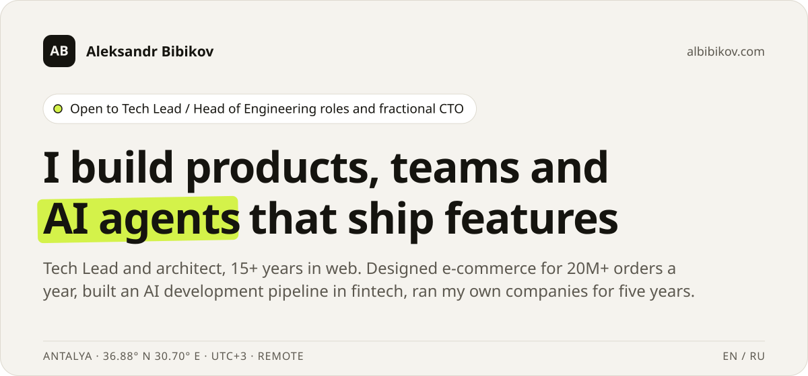
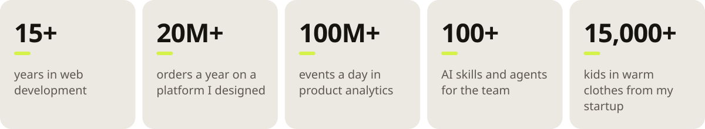
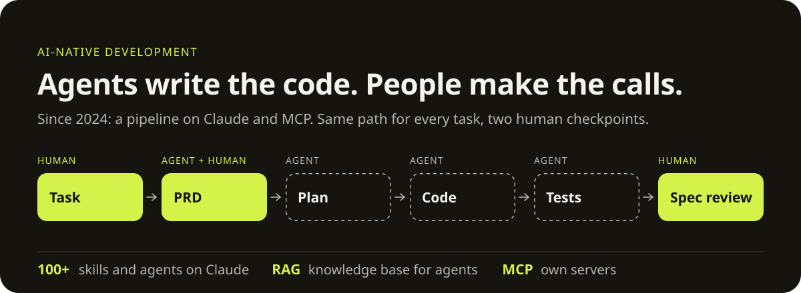

<a href="https://albibikov.com">
  <picture>
    <source media="(prefers-color-scheme: dark)" srcset="assets/hero-dark.svg">
    
  </picture>
</a>

  <a href="https://albibikov.com"><picture><source media="(prefers-color-scheme: dark)" srcset="assets/btn-site-dark.svg"></picture></a>&nbsp;
  <a href="https://www.linkedin.com/in/bibikov-aleksandr"><picture><source media="(prefers-color-scheme: dark)" srcset="assets/btn-linkedin-dark.svg"></picture></a>&nbsp;
  <a href="https://albibikov.com/blog"><picture><source media="(prefers-color-scheme: dark)" srcset="assets/btn-blog-dark.svg"></picture></a>&nbsp;
  <a href="mailto:abibikov.com@gmail.com"><picture><source media="(prefers-color-scheme: dark)" srcset="assets/btn-email-dark.svg"></picture></a>

<picture>
  <source media="(prefers-color-scheme: dark)" srcset="assets/stats-dark.svg">
  
</picture>

## What I bring to a team

**Architecture for growth.** API contracts, frontend architecture, CI/CD and the release process — systems that hold up at scale.  
→ e-commerce platform handling 20M+ orders a year

**AI-native development.** Agents scope tasks, write code and tests; people review against the spec.  
→ roughly half the manual work

**Teams and hiring.** Hiring, processes and teaching, so the team works without heroics and without me in every decision.  
→ 200+ interviews, 200+ internal lessons

**Product and growth.** Five years running my own companies, so every technical decision starts with what it costs the business.  
→ both of my companies' sites were #1 on Yandex for years

 

<picture>
  <source media="(prefers-color-scheme: dark)" srcset="assets/pipeline-dark.svg">
  
</picture>

## How I work

- **Spec first, code second.** A task starts with a document: what, for whom, and how we'll know it's done.
- **Processes that run without me.** The system I set up at Print Technologies still runs today.
- **Money in every decision.** Architecture, stack and hiring are costs — I compare options by price to the business.
- **AI takes the routine.** Agents do the repeatable work; people own the framing, architecture and final call.

 

<code>NAKHODKA → MOSCOW → ANTALYA · UTC+3 · REMOTE</code> · Open to Tech Lead / Head of Engineering roles and fractional CTO — <a href="https://albibikov.com">albibikov.com</a>
